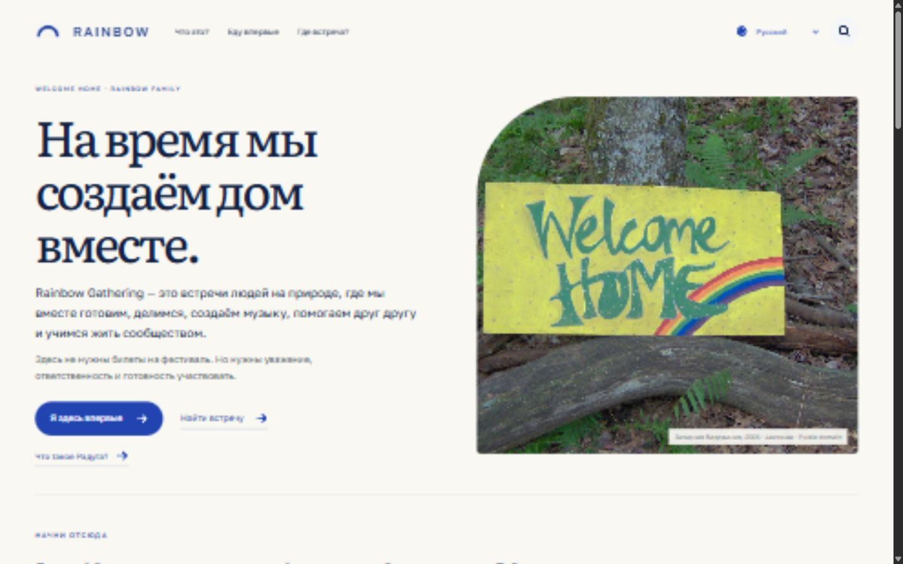
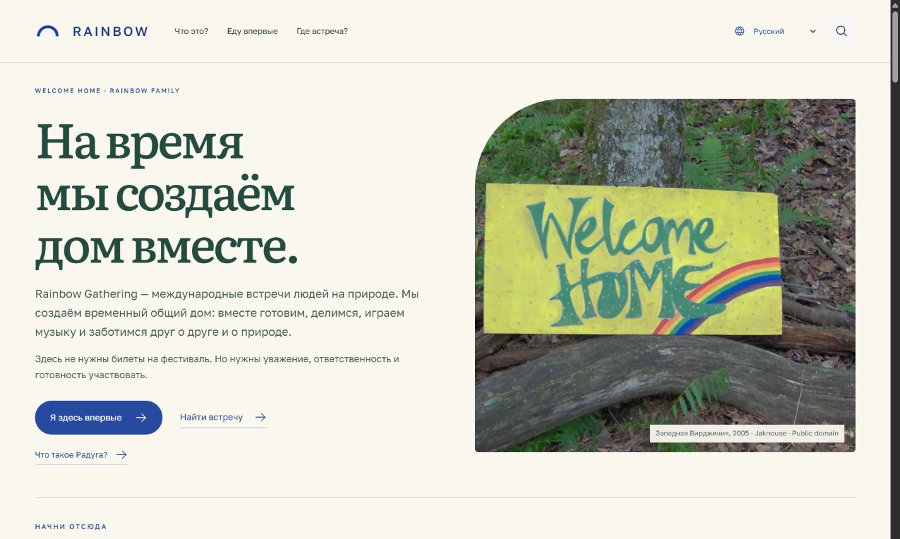
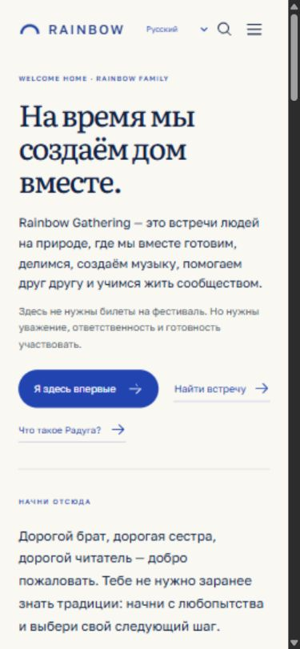
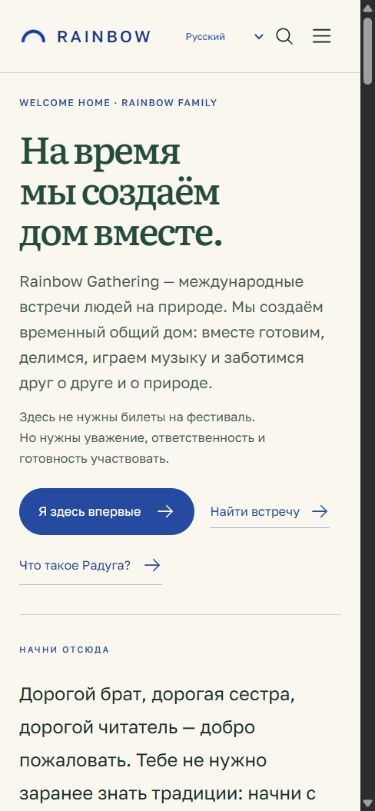
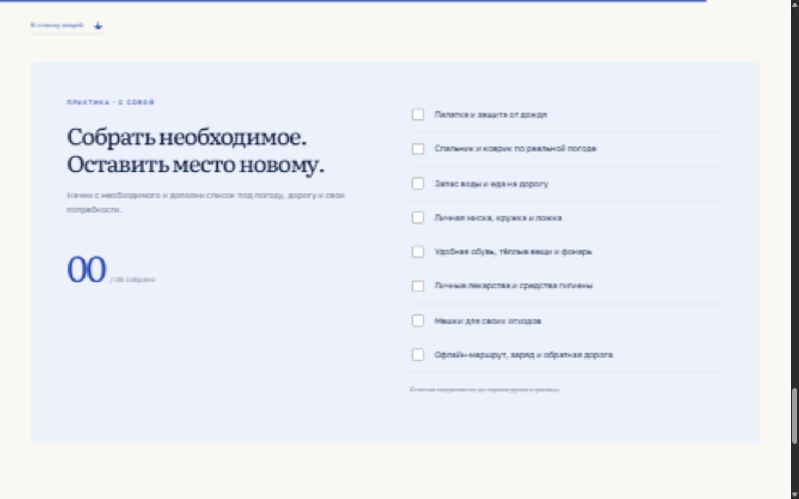
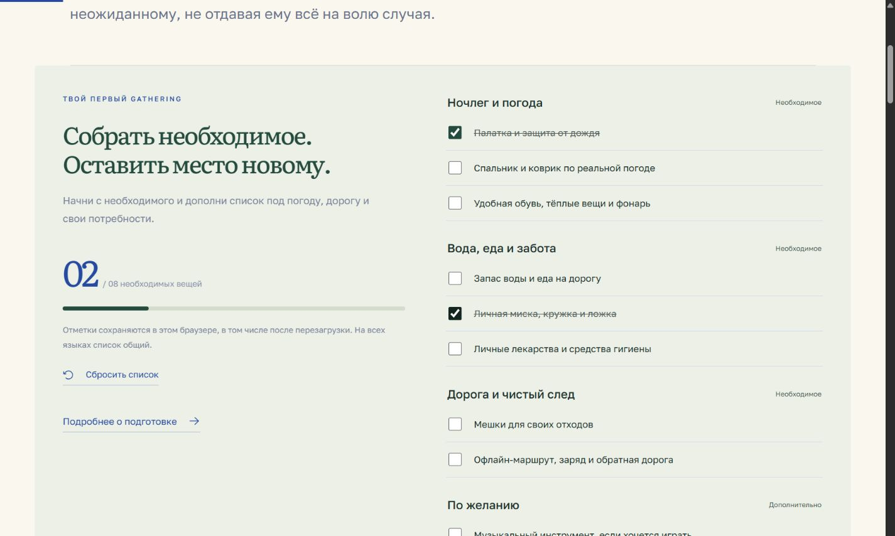
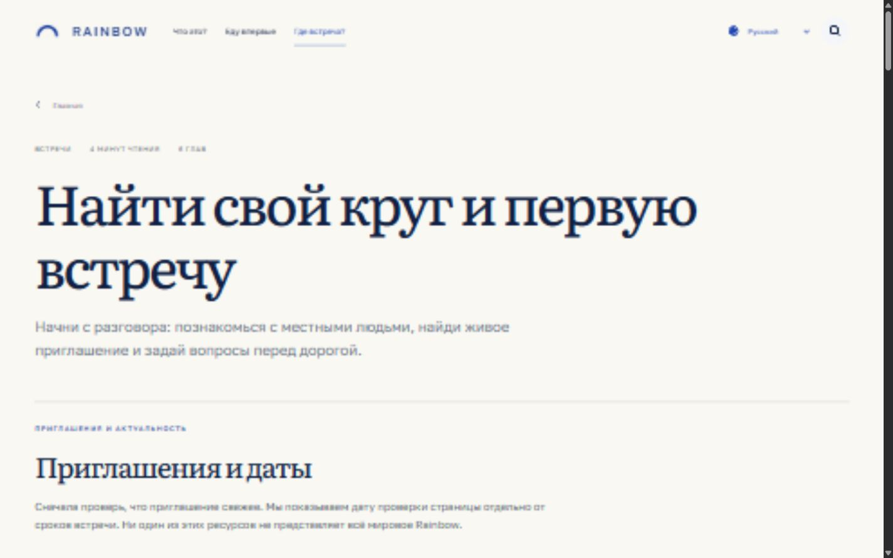
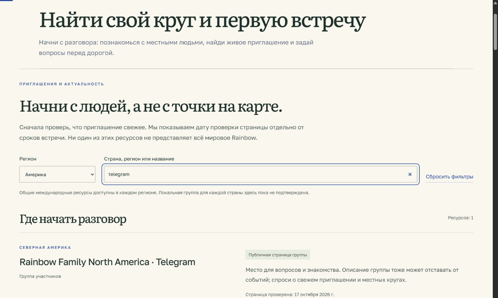
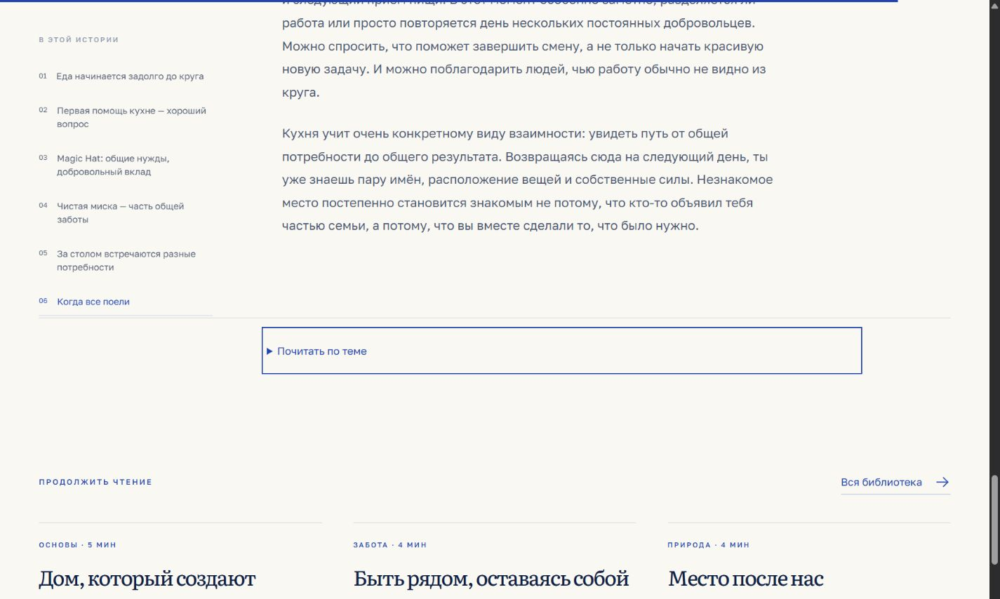
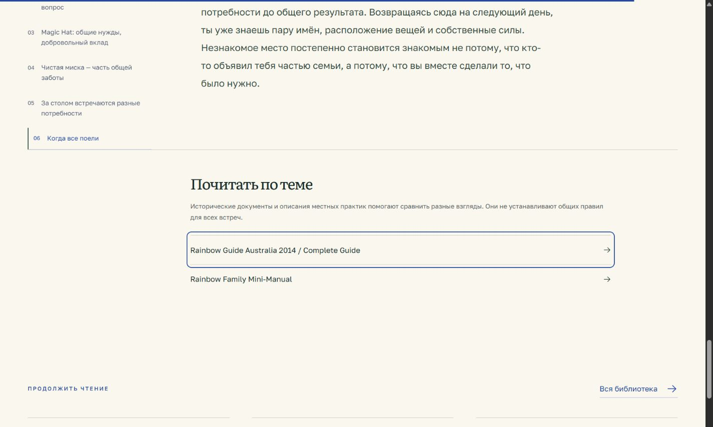

# Rainbow Welcome Home — аудит и улучшения

Проверка: 17 октября 2026 года. Исходная версия: `main` / `bf486cb`. Изменения: `codex/welcome-home-editorial-ux`. Действующий сайт не публиковался и не изменялся.

## Что было проверено

Аудит проведён на действующем сайте в браузере Codex: главная → первая поездка и список вещей → встречи. Снимки сделаны в этом запуске, сохранены и просмотрены. Затем сценарии проверены на локальной ветке. Это проверка интерфейса, кода и отдельных требований доступности, а не исследование с участниками и не сертификация WCAG.

1. **Первое знакомство — хорошая основа, улучшено.** Уже были три направления и понятное объяснение. Уточнён международный характер встреч, сохранено прямое обращение к читателю. Визуальная иерархия получила лесной зелёный, тёплую бумагу и более спокойные информационные подписи. Три действия видны на проверенных первых экранах.
2. **Подготовка — существенный пробел устранён.** В исходной версии восемь вещей находились после восьми глав, отметки терялись после перезагрузки, категорий и сброса не было. Теперь список доступен на главной и перед подробной статьёй: восемь необходимых пунктов, три дополнительных, четыре группы, прогресс и сохранение в браузере. Сбой хранилища не ломает страницу и объясняется читателю.
3. **Поиск встреч — маршрут стал практичнее.** Исходный фильтр региона относился к двум архивным приглашениям, но не к пяти ресурсам ниже. Каталог теперь идёт первым, фильтруется по региону и тексту; есть пример первого сообщения и честное пустое состояние. Архив и будущие приглашения отделены от каталога.
4. **Чтение и навигация — улучшено, остаются ограничения проверки.** Источники статей были свёрнуты. Теперь они открыто видны после текста; сохранены девять статей, библиография, тематические пути и прежние ссылки. Исторические ориентиры получили переключение и полный список. У поиска проверены Tab/Shift+Tab, Escape и возвращение фокуса; фон диалога исключается из взаимодействия и дерева доступности. Переходы ведут фокус к основному содержимому.

## До и после

Главная, десктоп:

Главная, телефон:

Подготовка:

Встречи:

Снимки передают реальный рендер браузера; исходные снимки браузер сохранил с более мягкой растеризацией. Это не макеты и не изображения, созданные ИИ.

Источники статьи:

## Решения и приоритеты

| Приоритет | Наблюдение | Реализовано |
| --- | --- | --- |
| P0 | Практическая подготовка требовала долгого чтения | Список перед статьёй и на главной; подробный текст сохранён |
| P0 | Отметки исчезали при обновлении | Стабильные идентификаторы, localStorage, сброс, обработка ошибок |
| P0 | Регион не фильтровал ресурсы | Общий поиск для каталога и приглашений, Европа / Америка / другие регионы |
| P1 | Источники были скрыты | Постоянно открытый блок дальнейшего чтения у статей |
| P1 | Главная слабо связывала рассказ с действием | Повседневная жизнь, подготовка, поиск круга и тёплое завершение |
| P1 | Узкая версия имела риск горизонтального сдвига | Убрана минимальная ширина body, исправлены поля и легенда прогулки |
| P1 | Длинная навигация не помещалась на планшете | Меню раскрывается и на промежуточных размерах |
| P1 | Язык HTML в dev не совпадал с прямым языковым URL | Синхронизация `html.lang`, языка URL и истории браузера |
| P1 | Выявлены уязвимые зависимости | Vite 6.4.4 и совместимые обновления lockfile; audit: 0 |
| P2 | Историческая шкала была набором ссылок | Переключаемый контекст, переход к главе и полный список без JS |

## Дизайн-система

Сохранены Open Horizon, локальные Literata и Golos Text, синие действия и существующие изображения. Палитра: бумага `#faf7ef`, лес `#244b3e`, текст `#1d302c`, синий `#254aa0`, терракота `#994c34`, солнечный `#e6c975`. Терракота и жёлтый используются ограниченно. Нет новых гарнитур, библиотек анимации или тяжёлой графики.

Изучены текущие публичные страницы [Emergence Magazine](https://emergencemagazine.org/), [Global Ecovillage Network](https://ecovillage.org/) и [Beautiful Trouble](https://beautifultrouble.org/). Полезные ориентиры — редакционные входы по типам историй, ясные пути к сообществам и тематическое раскрытие знаний. Композиции и материалы этих проектов не копировались.

Разные части главной имеют разный ритм: большой первый экран, рассказ с изображением, редакционные заметки, практический список, зелёное приглашение к разговору и спокойное завершение. Текст остаётся виден независимо от анимаций. Применён `prefers-reduced-motion`; нет звука, заставок и управления прокруткой.

## Встречи и форум

С ранее предоставленным пользователем доступом проверены раздел анонсов RainbowForum и отдельные свежие темы. Доступ после входа подтверждён, описание ресурса обновлено. В частности, встречаются приглашения с подробностями по запросу. Закрытые сообщения, контакты, координаты, сессионные ссылки и учётные данные не сохранялись в репозитории.

Свежие сообщения форума не выдаются за публичные приглашения, разрешённые к перепубликации. В текущем открытом каталоге по-прежнему нет записи будущей встречи, удовлетворяющей принятой политике первичного публичного приглашения и согласия на распространение. Интерфейс объясняет, что это состояние каталога, а не отсутствие встреч в мире. Общие международные источники остаются во всех региональных фильтрах и явно описаны как международные.

## Контент, переводы и медиа

Сохранены все девять статей, восемь FAQ, шесть остановок прогулки, двенадцать источников, шесть языков и прежние URL. Исторические утверждения не переписывались. Даты содержательного обновления статей не выдумывались: исходные данные не содержат надёжных дат для каждой статьи. Даты проверки ссылок не обозначают обновление статьи или подтверждение встречи.

Новые строки переведены во все пять дополнительных языков; ключевое определение, заголовки, категории списка и CTA проверены отдельно в `scripts/review-ux-locales.mjs`. Остальной перевод подготовлен автоматически с выборочной проверкой; это отражено на сайте, полного профессионального языкового редактирования не заявляется.

Документальная фотография сохранена с указанием автора и public-domain источника. Добавлены только WebP-копии для загрузки: 39 878 и 119 628 байт против 204 673 байт исходного JPEG. Оригинал сохранён. Фото людей, кухонь и кругов с разрешениями пока не предоставлены: существующие иллюстрации не выдаются за документальную съёмку, личные свидетельства не сочинялись.

## Проверки

- `npm run build`: успешная сборка, 240 языковых HTML-страниц, корневая страница, sitemap и robots.
- `npm test`: 20 / 20, включая полноту переводов, сохранность длинных статей, ссылки, метаданные, Worker, политику приглашений, сохранение списка и фильтры.
- `npm audit`: после совместимых обновлений 0 уязвимостей.
- Главная: ширины 320, 375, 390, 768, 1024 и 1440 px. Размеры и нижняя граница третьего действия сохранены в `responsive-home.json`. На 320 px отдельно проверены все шесть языков.
- Подготовка, встречи, история, прогулка, источники и FAQ проверены на шести размерах. Первичная проверка выявила мобильное переполнение прогулки; после исправления проверка повторена. JSON-файлы сохраняют исходные наблюдения и повторные результаты.
- Окончательная production-сборка: 42 сочетания маршрута и размера, горизонтальных переполнений нет (`final-production-layouts.json`). Предупреждений и ошибок в журнале браузера при этой проверке не обнаружено.
- Расчёт контраста основных пар CSS: текст/бумага 12,98:1, подпись/бумага 6,08:1, синий/бумага 7,65:1, светлый/лес 9,12:1, подпись/светло-зелёный 5,64:1. Это проверка этих цветовых пар, а не всех состояний интерфейса.
- На 320 px проверены подготовка и встречи на всех языках; дополнительно — все языки главной на 1024 px и прогулки на 320 px.
- В браузере: отметка → перезагрузка → смена языка → страница подготовки → сброс → перезагрузка; регион + поиск Telegram; открытие меню; поиск, фокус и Escape.
- Дополнительно: выбор 1998 года на шкале, переход к связанному источнику, смена языка и возврат назад; выбор кухни на схеме; раскрытие истории с клавиатуры. В production-поиске проверены цикл Tab и переход Enter с переносом фокуса в содержимое.
- Сохранены статические Open Graph / Twitter Card, изображение 1200×630, canonical и hreflang. Добавлены favicon, theme-color, подписи social image и полные locale-коды OG. Старые hash-ссылки продолжают поддерживаться.
- После смены каждого языка в собранной версии проверены OG locale, Twitter title, canonical и сохранение `x-default` (`client-metadata.json`). Метаданные обновляются и при переходах внутри приложения.

## Ограничения и следующие шаги

Нужны согласованные документальные истории и фотографии участников, публичные первичные приглашения и регулярная редакторская проверка каталога. Проверка доступности не охватывает все сочетания экранных дикторов, операционных систем, масштабирования и устройств. Реальный Telegram/WhatsApp cache и превью нового кода не проверялись: ветка не опубликована, сообщения третьим лицам не отправлялись. Нет измерений на физическом телефоне со слабой сетью или пользовательского теста понимания за 10–15 секунд.

Перед выпуском — просмотр ветки, при необходимости языковая вычитка, отдельное разрешение на публикацию и затем проверка реального хостинга и социальных предпросмотров. Автоматическая публикация в этой ветке не добавлялась.

## Изменённые файлы

Полный перечень — [CHANGED_FILES.txt](CHANGED_FILES.txt). Основные изменения: `Experience.jsx`, `Doors.jsx`, `i18n.jsx`, `SiteLink.jsx`; новые `Journey.jsx`, `packing-state.js`, `directory.js`, `editorial-ux.css`; все пять переводов и русский каталог; prerender, index, зависимости, медиа, тесты и этот отчёт. Файлы с текстами девяти статей и библиографическими данными не сокращались.
